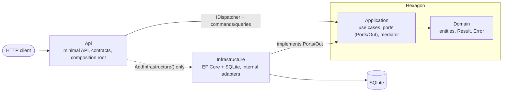

# Architecture

Hexagonal (ports and adapters): the business core knows nothing about databases, HTTP or frameworks.
Dependencies point inwards only.

| Project | References | Contains |
|---|---|---|
| `MyApp.Domain` | nothing | Entities, business rules and limits, `Result` / `Result<T>` (C# 15 unions), `Error`, domain errors |
| `MyApp.Application` | Domain | Use cases (command/query + handler + validator), `Ports/Out`, mediator (`Messaging`, `Behaviors`) |
| `MyApp.Infrastructure` | Application | Adapters: EF Core. All `internal`; only `AddInfrastructure()` is public |
| `MyApp.Api` | Application, Infrastructure | Endpoints, contracts, ProblemDetails mapping, `Program.cs` wiring |

Request flow: `Endpoint -> IDispatcher -> LoggingBehavior -> ValidationBehavior -> UnitOfWorkBehavior (commands) -> Handler -> Domain + Ports`.

## The 5 golden rules

1. **Dependencies point inwards.** Domain knows nothing; Application knows only Domain; adapters know Application.
2. **Business rules live in the Domain.** Entities have private setters and static factory methods that enforce invariants; the aggregate root creates its own children (`Order.Place` takes `OrderLineDraft`s, `OrderLine.Create` is `internal`) and reports every broken rule at once. The Domain never generates ids or reads the clock: both are parameters. Handlers orchestrate, they don't decide.
3. **Expected failures are `Result`, bugs are exceptions.** Never throw for "not found", "invalid input" or a storage conflict (the unit of work turns a duplicate key or concurrent update into a `Conflict` error).
4. **Talk to the outside world only through ports.** Storage is `IOrderRepository`; time is the built-in `TimeProvider` (registered by `AddApplication()`). One specific port per aggregate, using only domain types. Repositories stage changes; `IUnitOfWork` commits them.
5. **Never leak internals.** The Api never returns entities (map to `Api.Contracts`) and never touches ports; adapters are `internal`.

All five are enforced by the build (see the table in the README). If a rule blocks you, talk to the team. Do not edit the guardrail.

## Where does my code go?

| I want to... | Put it in |
|---|---|
| Add a business rule or invariant | `Domain/<Aggregate>`: entity factory or method, plus a Domain test |
| Add an error returned to callers | `Domain/<Aggregate>/<Aggregate>Errors.cs` |
| Add a use case | copy `Application/UseCases/PlaceOrder` (command + handler + validator) |
| Check request shape (is a field missing?) | the use case's `Validator` (shape only; ranges and limits belong in the Domain) |
| Add a limit or range (max length, quantity > 0) | a constant and a check in the Domain entity; reuse the constant in the EF mapping |
| Need something from the outside (DB, clock, HTTP service) | an interface in `Application/Ports/Out`, domain types only |
| Implement that interface | `Infrastructure/...` as an `internal` class, registered in `AddInfrastructure()` |
| Add an EF mapping | an `IEntityTypeConfiguration<T>` in `Infrastructure/Persistence` (picked up automatically) |
| Add an HTTP endpoint | `Api/Endpoints`; request/response records in `Api/Contracts`; call `IDispatcher` |
| Map an error to an HTTP status | `Api/Endpoints/ResultExtensions.cs` |
| Cross-cutting concern around every use case | an `IPipelineBehavior` in `Application/Behaviors`, registered in `AddApplication()` (order = execution order) |
| Change state | implement `ICommand<...>` (not `IRequest`); the handler stages changes through repositories and the pipeline saves them once, in one transaction, only on success. Never call `SaveChanges` yourself |
| Read the current time | inject `TimeProvider` and call `GetUtcNow()` (never `DateTime.UtcNow`) |
| Generate an id | in Application: `Guid.CreateVersion7(time.GetUtcNow())`, then pass it to the Domain (`Guid.NewGuid()` is banned) |
| Point a validation error at a field | set `Error.Target` to the camelCase input path (`customerId`, `lines[0].sku`); the API uses it as the `ValidationProblem` key, and falls back to `Code` |
| Read data for a query | `GetByIdReadOnlyAsync` (untracked). Commands use the tracked `GetByIdAsync` |

## Commands, queries and the unit of work

- A **query** implements `IRequest<Result<T>>` and never changes state.
- A **command** implements `ICommand<Result<T>>`. Its handler calls `repository.Add(...)` (staging only) and returns a `Result`.
- `UnitOfWorkBehavior` then calls `IUnitOfWork.SaveChangesAsync` once if, and only if, the result is a success. Everything the command staged is committed in one transaction. A validation or domain failure persists nothing.
- `IUnitOfWork.SaveChangesAsync` returns a `Result`. Expected storage failures (duplicate key, concurrent update) come back as a `Conflict` error, which the behavior returns as the command's own result (HTTP 409). Anything else is a bug and throws.
- Handlers never call `IUnitOfWork` themselves; an architecture test enforces it.
- `LoggingBehavior` also logs unhandled exceptions (then rethrows, so the API answers 500).

### Known limits (deliberate, revisit when they hurt)

- **Reads go through the aggregate.** Queries load the `Order` untracked and map it to a DTO. When a query needs a shape that is not an aggregate (lists, joins, projections), add a read port in `Ports/Out` and implement it with an EF projection instead of loading aggregates.
- **No concurrency token yet.** `Order` is immutable after placement, so there is nothing to race on. When you add behavior that changes an aggregate, add a concurrency token to its EF mapping: `UnitOfWork` already maps `DbUpdateConcurrencyException` to a `Conflict`.
- **`EnsureCreated`** stands in for migrations (see README).
- **Inbound ports.** There is no `Ports/In`: the inbound port is `IDispatcher` plus the command/query types in `UseCases`. Only outbound dependencies need an interface in `Ports/Out`.
- **Architecture tests are namespace/reference based** (NetArchTest). They can miss exotic dependency shapes; the banned-API analyzer covers *uses* on top of them. Treat the two together as the guardrail.

## Nothing to maintain for the guardrails

The banned-API rules ban whole namespaces (`Application.Ports.Out`, `Domain.Aggregates`, `Application.UseCases`, ...), and the architecture tests work on namespaces too. A new port, aggregate or use case is covered the moment you create it, as long as it lives in the right folder:
ports in `Application/Ports/Out`, entities in `Domain/Aggregates/<Name>`, use cases in `Application/UseCases/<Name>`.
