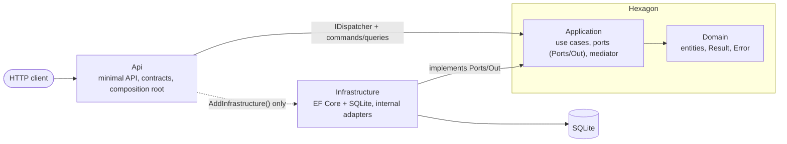

# Architecture

Hexagonal (ports and adapters): the business core knows nothing about databases, HTTP or frameworks.
Dependencies point inwards only.



| Project | References | Contains |
|---|---|---|
| `MyApp.Domain` | nothing | Entities, business rules and limits, `Result` / `Result<T>` (C# 15 unions), `Error`, domain errors |
| `MyApp.Application` | Domain | Use cases (command/query + handler + validator), `Ports/Out`, `ReadModels`, mediator (`Messaging`, `Behaviors`) |
| `MyApp.Infrastructure` | Application | Adapters: EF Core. All `internal`; only `AddInfrastructure()` is public |
| `MyApp.Api` | Application, Infrastructure | Endpoints, contracts, ProblemDetails mapping, `Program.cs` wiring |

Request flow: `Endpoint -> IDispatcher -> TelemetryBehavior -> LoggingBehavior -> ValidationBehavior -> UnitOfWorkBehavior (commands) -> IdempotencyBehavior (idempotent commands) -> Handler -> Domain + Ports`.

## The 5 golden rules

1. **Dependencies point inwards.** Domain knows nothing; Application knows only Domain; adapters know Application.
2. **Business rules live in the Domain.** Entities have private setters and static factory methods that enforce invariants; the aggregate root creates its own children (`Order.Place` takes `OrderLineDraft`s, `OrderLine.Create` is `internal`) and reports every broken rule at once. The Domain never generates ids or reads the clock: both are parameters. Handlers orchestrate, they don't decide.
3. **Expected failures are `Result`, bugs are exceptions.** Never throw for "not found", "invalid input" or a storage conflict (the unit of work turns a duplicate key or concurrent update into a `Conflict` error).
4. **Talk to the outside world only through ports.** Storage is `IOrderRepository`; time is the built-in `TimeProvider` (registered by `AddApplication()`). One specific port per aggregate, using only domain types. Repositories stage changes; `IUnitOfWork` commits them.
5. **Never leak internals.** The Api never returns entities (map to `Api.Contracts`) and never touches ports; adapters are `internal`.

All five are enforced by the build (see the table in the README). If a rule blocks you, talk to the team. Do not edit the guardrail.

## Where does my code go?

| I want to... | Put it in |
|---|---|
| Add a business rule or invariant | `Domain/<Aggregate>`: entity factory or method, plus a Domain test. State changes are methods that return `Result` and take the time as a parameter (see `Order.Cancel`, use case `CancelOrder`) |
| Add an error returned to callers | `Domain/<Aggregate>/<Aggregate>Errors.cs` |
| Add a use case | copy `Application/UseCases/PlaceOrder` (command + handler + validator) |
| Check request shape (is a field missing?) | the use case's `Validator` (shape only; ranges and limits belong in the Domain) |
| Add a limit or range (max length, quantity > 0) | a constant and a check in the Domain entity; reuse the constant in the EF mapping |
| Need something from the outside (DB, clock, HTTP service) | an interface in `Application/Ports/Out`, domain types only |
| Implement that interface | `Infrastructure/...` as an `internal` class, registered in `AddInfrastructure()` |
| Add an EF mapping (then add a migration, see Migrations below) | an `IEntityTypeConfiguration<T>` in `Infrastructure/Persistence` (picked up automatically) |
| Add an HTTP endpoint | `Api/Endpoints`; request/response records in `Api/Contracts`; call `IDispatcher` |
| Map an error to an HTTP status | `Api/Endpoints/ResultExtensions.cs` (mixed errors: the first non-validation error sets status and title; all errors are listed under `errors`) |
| Tell the outside world that something happened | raise a domain event from the aggregate (`readonly record struct` in the aggregate folder implementing `IDomainEvent`, with a versioned `Type` such as `order.placed.v1`). The outbox publishes it, see below |
| Send events to a real broker | implement `IMessagePublisher` as an `internal` class in `Infrastructure/Outbox` and register it before `AddInfrastructure()`; the logging default steps aside |
| Cross-cutting concern around every use case | an `IPipelineBehavior` in `Application/Behaviors`, registered in `AddApplication()` (order = execution order) |
| Change state | implement `ICommand<...>` (not `IRequest`); the handler stages changes through repositories and the pipeline saves them once, in one transaction, only on success. Never call `SaveChanges` yourself |
| Read the current time | inject `TimeProvider` and call `GetUtcNow()` (never `DateTime.UtcNow`) |
| Generate an id | in Application: `Guid.CreateVersion7(time.GetUtcNow())`, then pass it to the Domain (`Guid.NewGuid()` is banned) |
| Point a validation error at a field | set `Error.Target` to the camelCase input path (`customerId`, `lines[0].sku`); the API uses it as the `ValidationProblem` key, and falls back to `Code` |
| Read one aggregate for a query | `GetByIdReadOnlyAsync` (untracked). Commands use the tracked `GetByIdAsync` |
| Read a list or any shape that is not an aggregate | a read port in `Ports/Out` returning a flat record from `Application/ReadModels`, implemented with an EF projection (see `IOrderReadStore` and `ListOrders`). Never load aggregates to build a list |
| Add an aggregate | folder `Domain/Aggregates/<Name>`, a port in `Ports/Out`, an `IEntityTypeConfiguration<T>` that calls `builder.UseConcurrencyToken()`, a repository in Infrastructure. Tests tell you what is missing |

## Commands, queries and the unit of work

- A **query** implements `IRequest<Result<T>>` and never changes state.
- A **command** implements `ICommand<Result<T>>`. Its handler calls `repository.Add(...)` (staging only) and returns a `Result`.
- `UnitOfWorkBehavior` then calls `IUnitOfWork.SaveChangesAsync` once if, and only if, the result is a success. Everything the command staged is committed in one transaction. A validation or domain failure persists nothing.
- `IUnitOfWork.SaveChangesAsync` returns a `Result`. Expected storage failures (duplicate key, concurrent update) come back as a `Conflict` error, which the behavior returns as the command's own result (HTTP 409). Anything else is a bug and throws.
- Handlers never call `IUnitOfWork` themselves; an architecture test enforces it.
- The order is pinned by `PipelineOrderTests`: Telemetry, Logging, Validation, UnitOfWork (commands only), then Idempotency (idempotent commands only, innermost so its record is saved in the same transaction).
- `LoggingBehavior` also logs unhandled exceptions (then rethrows, so the API answers 500).

### Concurrency

Every aggregate root carries a shadow `Version` (a time-ordered `Guid`) configured with `UseConcurrencyToken()`. `AppDbContext` stamps a new value on every save of the root, including when only an owned child changed, so a stale writer fails with `DbUpdateConcurrencyException`, which `UnitOfWork` turns into a `Conflict` result (409). The Domain stays unaware of it. `ConcurrencyTests.Every_aggregate_root_has_a_concurrency_token` fails if you add an aggregate without it.

### Idempotency

A command that creates something implements `IIdempotentCommand<T>` (instead of `ICommand<Result<T>>`) and exposes `IdempotencyKey`; the endpoint fills it from the `Idempotency-Key` header and the validator checks it with `IdempotencyKeys.Check`. `IdempotencyBehavior` runs innermost. With a key it looks the key up (scope = command type) through `IIdempotencyStore`: a hit with the same request fingerprint replays the stored value without running the handler; a hit with another fingerprint is a `Conflict`; a miss runs the handler and, on success, stages a record that the unit of work saves with the command's own changes. Two concurrent first calls both insert the record and the unique key makes the loser fail as a `Conflict`, rolling back its changes. Failures are not recorded, so a corrected retry can reuse the key.

### Domain events and the outbox

An aggregate raises events in its own methods (`Order.Place` raises `OrderPlaced`, `Order.Cancel` raises `OrderCancelled`); it implements `IHasDomainEvents`, so the persistence layer can collect them. When `AppDbContext` saves, every event of every tracked aggregate becomes a row in `OutboxMessages`, added to the same `SaveChanges`: **the event is saved if and only if the change is**. A failed or rolled-back command leaves no message, and a crash after the commit cannot lose one. The events are cleared from the aggregate only after the save succeeded.

`OutboxRelay` (a background service, registered by `AddInfrastructure()`) then runs `OutboxProcessor` in a loop: it reads pending rows oldest first (`Sequence`), calls `IMessagePublisher.PublishAsync` for each and marks the row processed.

- **At least once.** A crash between publishing and marking sends the message again. Every message has a stable `MessageId`; consumers must ignore one they have already handled (that is the inbox side, on the consumer).
- **Ordered.** The first failure ends the batch, so a later message never overtakes an earlier one.
- **Retries and dead letters.** A failing message is retried on every poll. After `OutboxMessage.MaxAttempts` (5) it is dead-lettered: it stays in the table with `LastError`, is logged as an error and no longer blocks the others. Watch for `Attempts >= 5 AND ProcessedAt IS NULL`.
- **Default adapter.** `LoggingMessagePublisher` only logs, so the template runs without a broker. It is the one thing you replace.
- **Several instances.** Only the instance holding the `outbox-relay` lease publishes (see Running several instances). `BackgroundJobs:Enabled=false` turns the relay and the purge off in a process. `Outbox:PollIntervalSeconds` sets the poll (default 2).
- **Not in the outbox:** commands do not call the publisher and the Domain does not know it exists. A new event needs only the raise, the `Type` name, and a consumer.

Add an event: a `readonly record struct` next to the aggregate (`[StructLayout(LayoutKind.Auto)]`, implementing `IDomainEvent`), a raise in the aggregate method, a Domain test. No migration and no mapping: the payload is JSON.

### Retention

Two tables only grow unless something deletes from them, so `RetentionWorker` (hourly, under the `retention` lease) runs `RetentionPurger`:

- **Idempotency records** older than the retention. A client that retries later than that gets a second order, so keep it longer than any client's retry window.
- **Delivered outbox messages** older than the retention. Messages that were never delivered, and dead-lettered ones, are **never** deleted: a person has to look at them.

The retention is `Retention:Days` (default 7). The purge compares timestamps on the server, and SQLite cannot compare its default `DateTimeOffset` text, so `IdempotencyRecord.CreatedAt` and `OutboxMessage.ProcessedAt` are stored as UTC ticks (`UtcTicksConverter`). Do the same for any timestamp a query filters or sorts on.

### Running several instances

Everything that runs in the background is safe to run on every instance; the database decides who works.

| Concern | How it is made safe |
|---|---|
| Outbox relay | A lease row (`RelayLeases`, name `outbox-relay`). The holder renews it every poll; the others poll it and stand by. If the holder dies, the lease expires (30 seconds, or 15 polls if longer) and another instance takes over. One publisher at a time keeps the **global order** of messages, which competing relays could not. A holder that stalls past its lease can be overtaken: that message may then be delivered twice, which at-least-once allows. |
| Retention purge | Same lease mechanism (`retention`). |
| Taking a lease | Optimistic concurrency, no extra infrastructure: the lease row carries the version token and the first row has a unique key, so of several instances racing, exactly one wins and the others get a `Conflict`. `LeaderLeaseTests` races four at once. |
| Placing the same order twice at once | The idempotency record's unique key: the loser's whole command rolls back as a `Conflict`. |
| Two edits of one order | The aggregate's version token (`Conflict`, HTTP 409). |
| Migrations | Not coordinated. With more than one instance set `Database:MigrateOnStartup=false` and run `dotnet ef database update` (or a migration bundle) as a deploy step before the new version starts. |

SQLite is a file: several instances can only share it on one machine. The mechanisms above use nothing SQLite-specific (they rely on EF's concurrency token and unique keys), so they carry over to a server database when you switch provider.

### Migrations

The schema comes from EF migrations in `Infrastructure/Persistence/Migrations`. `MigrationTests` fails when the model changes without one. To add one:

```bash
dotnet tool restore
dotnet ef migrations add <Name> --project src/MyApp.Infrastructure --startup-project src/MyApp.Infrastructure --output-dir Persistence/Migrations
```

EF generates `<timestamp>_<Name>.cs`, a `.Designer.cs`, and updates `AppDbContextModelSnapshot.cs`. The layout rules (one type per file, named after it; no `#pragma warning disable`; Infrastructure exports nothing) need three manual steps, which the existing `Initial.cs` shows:

1. Fold the designer file into the migration file: one `internal sealed class <Name> : Migration` with `[DbContext(typeof(AppDbContext))]`, `[Migration("<id>")]`, `Up`, `Down` and `BuildTargetModel`. Name the file `<Name>.cs`, keep the `// <auto-generated />` header, delete the two generated files.
2. Remove the `#pragma warning disable/restore 612, 618` lines from the migration and from the snapshot.
3. Make the snapshot `internal sealed` instead of `partial`.

If the layout test learns to skip `Migrations/`, these steps disappear. That is a guardrail change for a human to decide.

### Observability and health

`AddObservability()` in the Api wires OpenTelemetry: ASP.NET Core instrumentation plus the Application's own `ActivitySource` and `Meter` (`Telemetry.Name`). `TelemetryBehavior` is the outermost step, so every log written inside a use case carries its trace id, and every error response carries `traceId`. Metrics: `myapp.requests` (counter) and `myapp.request.duration` (histogram, ms), tagged `request` and `outcome` (`success`, `failure`, `error`). Exporting is off until `OTEL_EXPORTER_OTLP_ENDPOINT` is set. Health probes: `/health/live` (no checks) and `/health/ready` (checks tagged `ready`, registered by `AddInfrastructure()`).

### Versioning and API docs

Routes live under `/v1` (`Api/Hosting/ApiVersions.cs`). A breaking change adds a `v2` group (and `AddOpenApi("v2")`) and keeps v1 until it is retired; an additive change stays in v1. OpenAPI (`/openapi/v1.json`) and Scalar (`/scalar/v1`) are mapped in Development only. Describe a new endpoint with `WithName`, `WithSummary` and `Produces...`.

### Known limits (deliberate, revisit when they hurt)

- **Single reads go through the aggregate.** `GetOrder` loads the `Order` untracked and maps it to a DTO. Lists and other shapes use a read port with a projection (`ListOrders`); copy that when a query needs joins or filters. A derived value (the order total) is computed once by the aggregate and stored, so projections read it and never recompute a business rule.
- **Paging bounds** live in the use case validator: they protect the service, they are not a business rule.
- **Only the first success of an idempotent command is recorded**, never failures. Records live as long as `Retention:Days`.
- **There is no consumer-side inbox.** The idempotency record is the inbox for HTTP retries; a consumer of these events (another service) needs its own inbox keyed by `MessageId`. Dead-lettered outbox messages are kept for a person to inspect and are not alerted on: add an alert on `Attempts >= 5 AND ProcessedAt IS NULL`.
- **The relay polls.** Latency is at most the poll interval; there is no push or change feed. Fine until it is not.
- **Migrations on startup** suit one instance (see Running several instances).
- **Versioning is by URL segment, by hand.** It needs no package. Move to Asp.Versioning when you run several versions at once and want deprecation headers.
- **Inbound ports.** There is no `Ports/In`: the inbound port is `IDispatcher` plus the command/query types in `UseCases`. Only outbound dependencies need an interface in `Ports/Out`.
- **Architecture tests are namespace/reference based** (NetArchTest) and `ProjectFileTests` read the `.csproj` files. They can miss exotic dependency shapes; the banned-API analyzer covers *uses* on top of them. Treat them together as the guardrail.

## Nothing to maintain for the guardrails

The banned-API rules ban whole namespaces (`Application.Ports.Out`, `Domain.Aggregates`, `Application.UseCases`, ...), and the architecture tests work on namespaces too. A new port, aggregate or use case is covered the moment you create it, as long as it lives in the right folder:
ports in `Application/Ports/Out`, entities in `Domain/Aggregates/<Name>`, use cases in `Application/UseCases/<Name>`.
